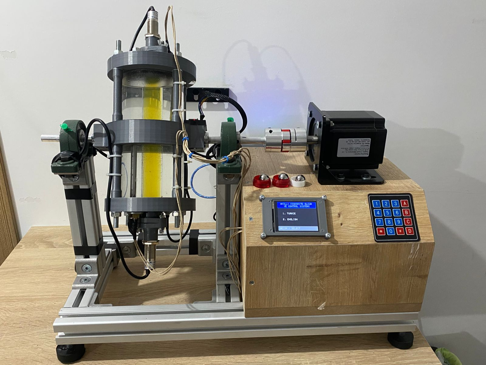
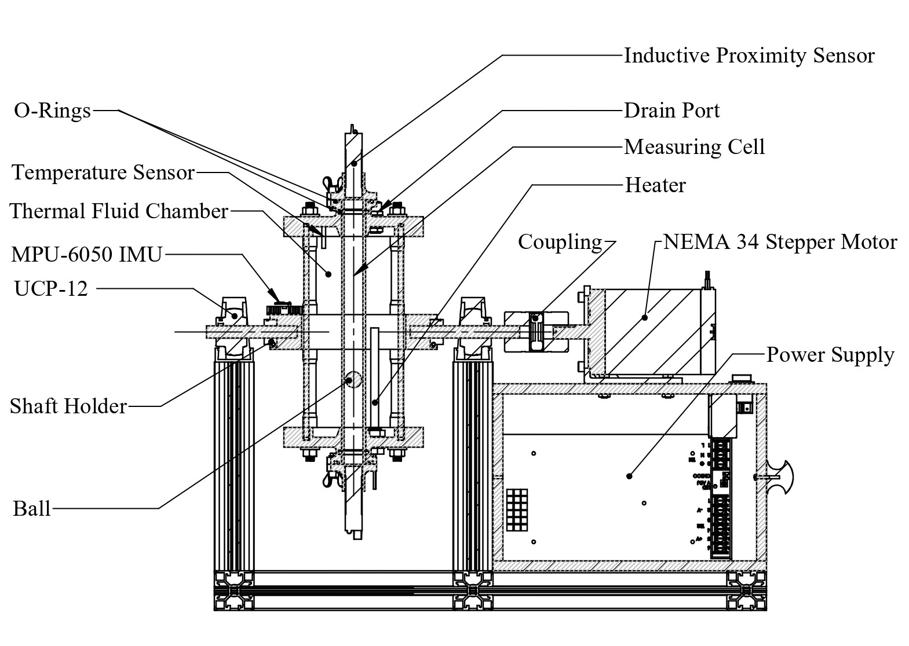

# 🔬 VYTRON: Smart Viscosity Measurement and Control System


-blue)


VYTRON is an automated **falling-ball viscometer** developed as a **TÜBİTAK 2209-A** research project. Based on **Stokes' Law**, it turns the traditional manual falling-ball method into a fully automated, high-precision mechatronic system: the sample tube is rotated by a stepper motor, the ball's fall is timed, the fluid temperature is tracked, and viscosity is calculated and reported in real time.

This repository contains the **firmware, circuit schematics, and mechanical CAD files** of the system.



---

## 📑 Table of Contents

- [How It Works](#-how-it-works)
- [Key Features](#-key-features)
- [System Architecture](#-system-architecture)
- [Hardware](#-hardware)
- [Repository Structure](#-repository-structure)
- [Getting Started](#-getting-started)
- [Usage](#-usage)
- [Developer Guide](#-developer-guide)
- [Safety](#-safety)
- [Roadmap](#-roadmap)
- [License](#-license)
- [Acknowledgements](#-acknowledgements)

---

## ⚙️ How It Works

A sphere of known size and density falls through the sample fluid in a sealed tube. The time it takes to travel between two reference points gives its terminal velocity, from which dynamic viscosity is derived with Stokes' Law:

```
η = 2 · (ρs − ρf) · g · r² / (9 · v)
```

| Symbol | Meaning |
|--------|---------|
| η | Dynamic viscosity (Pa·s) |
| ρs, ρf | Density of the sphere / the fluid (kg/m³) |
| g | Gravitational acceleration (m/s²) |
| r | Sphere radius (m) |
| v | Terminal velocity (m/s) |

Because the ball falls in a bounded tube, the result is multiplied by a **wall-effect correction factor** to account for the tube boundary.

**Measurement cycle**
1. The tube is rotated to the start position and its tilt is verified (MPU-6050).
2. The fluid temperature is read (DS18B20).
3. The tube is flipped by the stepper motor and the ball's fall time is measured.
4. Viscosity is computed with the wall-effect correction and reported.

---

## 📌 Key Features

- **Automated viscosity calculation** with Stokes' Law and wall-effect correction.
- **Dual-microcontroller architecture** with synchronized Mega ↔ Nano communication.
- **Real-time sensor processing** for temperature and tilt/orientation.
- **EMI-aware electronics design**: filtering for the stepper driver and sensor lines to keep measurements stable.
- **Closed-loop tube positioning** using MPU-6050 tilt feedback.
- **Chemically resistant, leak-free mechanics** with NBR O-rings and Viton (FKM) seals.
- **Bilingual interface (Turkish / English)** on ILI9341 TFT LCD.
- **4×4 matrix keypad** on both Mega and Nano.
- **20×4 I2C LCD** on Nano for motion status.
- **SSR heater control** with ETA (remaining time) display.
- **Last 5 measurement history** on screen.
- **EEPROM calibration persistence** for ball density, K coefficient, wall factor, and target temperature.
- **Optical ball detection sensors** with hardware interrupt for microsecond-precision timing.
- **AccelStepper profiling** for smooth motor acceleration and deceleration.
- **Software-level noise mitigation** (I2C timeout, interrupt debouncing, moving average filter).

---

## 🧠 System Architecture

| Controller | Role |
|------------|------|
| **Arduino Mega 2560** (Main MCU) | Master control logic, temperature tracking, viscosity calculation, rotational position via MPU-6050, measurement sequencing |
| **Arduino Nano** (Motion MCU) | Controls tube position and drives the stepper driver |

```
 ┌──────────────┐                                            ┌──────────────┐
 │ Arduino Mega │ ◄────────────────────────────────────────► │ Arduino Nano │
 │   (Master)   │          Serial1 communication            │   (Motion)   │
 └──────┬───────┘                                            └──────┬───────┘
        │                                                           │
 DS18B20 (temp), MPU-6050 (tilt), ILI9341 TFT, keypad         JSS-860H ► NEMA 34
        │                                                           │
   Optical Sensors A & B (ball detection)                    20×4 I2C LCD
```

**Mega ↔ Nano commands (Serial1):**
- `H` : Stepper +400 steps (clockwise)
- `G` : Stepper -400 steps (counter-clockwise)
- `S` : Stepper position zero (`moveTo(0)`)

---

## 🔩 Hardware

| Component | Purpose |
|-----------|---------|
| Arduino Mega 2560 | Main controller |
| Arduino Nano | Motion controller |
| DS18B20 | Digital temperature sensor |
| MPU-6050 | 6-axis gyro/accelerometer for tilt and position tracking |
| NEMA 34 stepper motor | High-torque tube rotation |
| JSS-860H driver | Stepper motor driver |
| ILI9341 TFT LCD | Main interface (SPI, TR/EN) |
| 20×4 I2C LCD | Nano motion status screen |
| 4×4 matrix keypad × 2 | User input (Mega and Nano) |
| SSR (Solid State Relay) | 200W heater control |
| 220V / 200W heater | Fluid heating |
| NBR O-ring, Viton (FKM) seals | Sealing and chemical resistance |
| 48V / 12V power supply | Stepper and logic power |

**Mechanical design:** Modeled and assembled in **SolidWorks**, with custom-engineered sealing channels.

**Electronics:** KiCad schematic in `Electronics/`; EMI protection using aluminum shielded cables, ferrite cores, and capacitor filtering.

### Technical Diagram

The diagram below shows the main mechanical modules of the VYTRON system:



---

## 📁 Repository Structure

```
Smart-Viscosity-Measurement-and-Control-System-VYTRON/
├── Software/
│   ├── Mega_IDE.ino        # Arduino Mega 2560 (main MCU) firmware
│   └── Nano_IDE.ino        # Arduino Nano (motion MCU) firmware
├── Electronics/
│   ├── Smart Viscosity Measurement and Control System.kicad_sch   # KiCad schematic
│   ├── Dual-microcontroller control panel and power architecture..jpg
│   ├── Detail_of_Parts/                 # Component and prototype photos
│   └── Interference_Mitigation/         # EMI/RFI noise suppression photos and notes
├── Mechanical/
│   ├── 3D Model/                # SolidWorks CAD files (.sldprt, .sldasm) and STEP
│   ├── CFD_Analysis/            # Ansys Fluent CFD simulation files
│   ├── Mechanical Calculations/ # Mechanical calculation files
│   └── Techincal_Drawing/       # Technical drawings (PDF)
├── docs/
│   ├── getting-started.md       # Setup and first run guide
│   ├── wiring-guide.md          # Detailed pin connection guide
│   ├── assembly-guide.md        # Mechanical assembly guide
│   ├── calibration.md           # Calibration procedure (HD-46VG, 40 °C / 46 cSt)
│   ├── cfd-analysis.md          # Ansys Fluent CFD flow analysis
│   ├── comparison.md            # VYTRON vs laboratory viscometer comparison
│   ├── safety.md                # Safety guide (220V, heat, mechanical)
│   ├── pricing.md               # Production cost analysis
│   ├── software-architecture.md # Software architecture and algorithms
│   ├── mechanical-design.md     # Mechanical design and fluid dynamics
│   ├── electronics/interference-mitigation.md
│   ├── bom/
│   │   ├── bom-index.md         # Bill of Materials general overview
│   │   ├── electronics-bom.md   # Electronic BOM
│   │   ├── mechanical-bom.md    # Mechanical BOM
│   │   └── files/               # BOM_Electronic_VYTRON.xlsx, BOM_Mechanic_VYTRON.xlsx
│   ├── tubitak/                 # TÜBİTAK 2209-A report and paper
│   └── use-cases/               # Academic, automotive, food, petrochemical, pharma use cases
├── .gitignore
├── CHANGELOG.md                 # Version history
├── CODE_OF_CONDUCT.md           # Code of Conduct
├── LICENSE.txt                  # All Rights Reserved license
└── README.md                    # Project overview (this file)


---

## 🚀 Getting Started

### Prerequisites

**Software:**
- [Arduino IDE](https://www.arduino.cc/en/software) 2.x (or PlatformIO)
- Required Arduino libraries (install via Library Manager):
  - `Adafruit_ILI9341` & `Adafruit_GFX`
  - `DallasTemperature` & `OneWire`
  - `AccelStepper`
  - `LiquidCrystal_I2C`
  - `Keypad`

**Hardware:**
- Assembled VYTRON prototype (see `docs/assembly-guide.md` and `docs/wiring-guide.md`)
- Arduino Mega 2560, Arduino Nano
- NEMA 34 stepper motor + JSS-860H driver
- DS18B20 temperature sensor, MPU-6050 tilt sensor
- ILI9341 TFT LCD (SPI), 2× 4×4 keypad, 20×4 I2C LCD
- Solid State Relay (SSR), 220V / 200W heater
- NBR O-ring and Viton (FKM) gaskets

### Build & Upload

1. Clone the repository:
   ```bash
   git clone https://github.com/rashadrahimzade/Smart-Viscosity-Measurement-and-Control-System-VYTRON.git
   cd Smart-Viscosity-Measurement-and-Control-System-VYTRON
   ```
2. Wire the system according to the diagrams in `Electronics/`.
3. Open the Mega sketch from `Software/`, select **Arduino Mega or Mega 2560**, and upload.
4. Open the Nano sketch from `Software/`, select **Arduino Nano** (check the bootloader option), and upload.
5. Power the system and verify the sensor readings on the serial monitor.

### First Power-Up Checklist

- [ ] TFT shows VYTRON logo, then language selection
- [ ] DS18B20 reads a plausible room temperature (~20–25 °C)
- [ ] MPU-6050 shows stable roll/pitch values
- [ ] Nano LCD shows ball selection screen
- [ ] Stepper responds to Mega serial commands (H / G / S)
- [ ] SSR toggles heater when target temperature is set
- [ ] Optical sensors detect ball passage (check `sensorAktif` flag)

---

## 🕹️ Usage

1. Fill the tube with the sample fluid and seal it with NBR O-rings.
2. Insert the ball (16 mm, 17 mm, or 18 mm).
3. On the TFT, select the language (1 = Turkish, 2 = English).
4. Select the ball type; the system automatically loads `bilyeYogunluk` and `bilyeK_Sabiti`.
5. Enter the fluid density.
6. Run MPU-6050 calibration and set the target temperature.
7. Once the fluid reaches the target temperature, start the measurement cycle.
8. Read the dynamic and kinematic viscosity values on the screen.

**Ball options:**
| Ball | Density (g/cm³) | K Coefficient | Description |
|------|-----------------|---------------|-------------|
| 16 mm | 16.75 | 0.870 | Light ball; does not require very high rotation speed |
| 17 mm | 7.78 | 1.482 | Medium ball; standard rotation speed |
| 18 mm | 7.79 | 0.831 | Heavy ball; standard rotation speed |

**Wall-effect factor:** `fSabiti = 0.952` (calculated via the Ladenburg method, calibrated with HD-46VG reference fluid).

---

## 👨‍💻 Developer Guide

### Coding Standards (Arduino / Embedded)

- Use consistent indentation (2 or 4 spaces).
- Avoid the `String` class in performance-critical ISR or loop code to prevent memory fragmentation.
- Keep interrupt service routines (ISR) short; do not call `delay()` or `Serial.print()` inside an ISR.
- Use `volatile` for variables shared between ISR and `loop()`.
- Pin definitions should be at the top of the sketch with `#define`.
- Keep Turkish and English UI labels consistent where applicable.

### Contact

For permission requests, bug reports, or questions, email: **rahimzaderashad1@gmail.com**

---

## ⚠️ Safety

The system contains **220V AC**, high temperature, and moving mechanical parts. Read [`docs/safety.md`](./docs/safety.md) before use.

**Important warnings:**
- 220V AC connections must only be made by qualified personnel.
- All 220V cables must be double-insulated and kept in a suitable enclosure.
- The 200W heater and glass tube pose a burn risk; do not touch them while the heater is operating.
- The NEMA 34 stepper motor produces high torque; do not bring your hand or clothing near the motor rotation area.
- The glass tube is fragile; it can break due to impact or dropping.

**Emergency procedure:**
1. Immediately cut 220V from the power source.
2. For motor-related faults, use the **emergency switch mounted on top of the wooden box** to cut motor power directly.
3. Disconnect the Arduinos from USB.
4. Wait for hot parts to cool down.
5. Restart only after identifying the source of the problem.

---

## 🗺️ Roadmap

- [ ] Calibration with reference-viscosity fluids and accuracy report
- [ ] Data logging (SD card / PC)
- [ ] Temperature-controlled measurement chamber
- [ ] Wiring diagram and photos of the finished prototype

---

## 📄 License

Full license text: [LICENSE.txt](./LICENSE.txt)

**Copyright © 2026 Rashad Rahimzade. All rights reserved.**

This repository and everything in it (firmware, circuit schematics, mechanical CAD files, documentation and images) may not be copied, modified, distributed, or used in any other project, commercial or non-commercial, without the author's prior written permission.

To request permission, please contact the author by email: **rahimzaderashad1@gmail.com**

---

## 🙏 Acknowledgements

This project was supported by the **TÜBİTAK 2209-A** University Students Research Projects Support Program.

**Author:** [@rashadrahimzade](https://github.com/rashadrahimzade)

---

### Related Documents

| Document | Description |
|----------|-------------|
| [`docs/getting-started.md`](./docs/getting-started.md) | Setup and first run guide |
| [`docs/wiring-guide.md`](./docs/wiring-guide.md) | Detailed pin connection table |
| [`docs/assembly-guide.md`](./docs/assembly-guide.md) | Mechanical assembly guide |
| [`docs/calibration.md`](./docs/calibration.md) | Calibration procedure |
| [`docs/safety.md`](./docs/safety.md) | Safety guide |
| [`docs/pricing.md`](./docs/pricing.md) | Production cost analysis |
| [`docs/cfd-analysis.md`](./docs/cfd-analysis.md) | Ansys Fluent CFD analysis |
| [`docs/comparison.md`](./docs/comparison.md) | Laboratory viscometer comparison |
| [`docs/bom/bom-index.md`](./docs/bom/bom-index.md) | Bill of Materials (BOM) |
| [`CHANGELOG.md`](./CHANGELOG.md) | Version history |
| [`CODE_OF_CONDUCT.md`](./CODE_OF_CONDUCT.md) | Code of Conduct |


